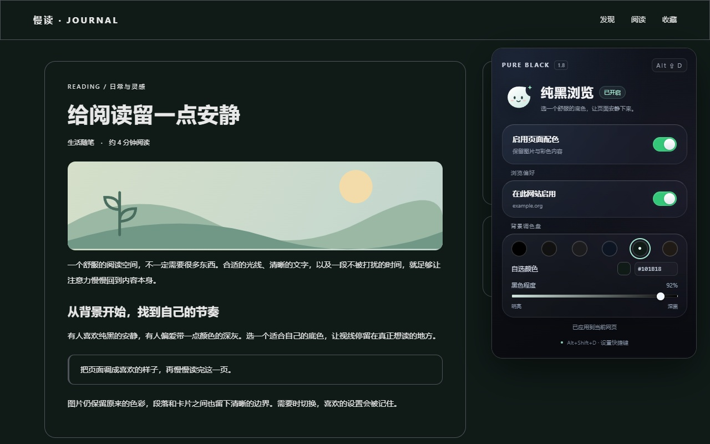

# 纯黑浏览 · Pure Black

让网页拥有你喜欢的底色。适用于桌面版 Chrome 和 Edge 的 Manifest V3 扩展，当前版本 **1.8.1**。



## 功能

- 一键使用纯黑、炭黑、石墨、午夜蓝、松林绿或暖墨背景。
- 支持取色器、十六进制色值和明暗滑块。
- 按区域背景调整文字对比度，为失去分隔的卡片补上细轮廓线。
- 支持网站开关，并自动保存本机设置。
- `Alt+Shift+D` 切换全局配色，搭配与 Logo 一致的太阳、月亮动画。
- 尽量保留照片、视频和彩色内容，对部分小型深色图标改善可见性。

## 安装

1. 下载 [1.8.1 安装包](https://github.com/cut-hand/crx-pure-black-extension/releases/download/v1.8.1/Pure-Black-1.8.1.zip) 并解压，或下载本仓库源码。
2. 打开 `chrome://extensions` 或 `edge://extensions`，开启“开发者模式”。
3. 点击“加载解压缩的扩展程序”，选择直接包含 `manifest.json` 的文件夹。
4. 刷新已经打开的网页，在工具栏固定“纯黑浏览”图标。

修改源码后，在扩展管理页点击“重新加载”并刷新网页。如果快捷键冲突，可点击扩展弹窗中的快捷键入口重新设置。

## 1.8.1 更新

修复纯黑模式下残留的黑白灰背景渐变，包括 Chrome“新变化”内容页底部轮播栏的灰色光晕。渐变遮罩移除后保持透明，避免遮挡卡片；彩色渐变、渐变文字和包含图片的背景保留。已有用户解压覆盖原目录后，重新加载扩展并刷新网页即可。

## 隐私与权限

无需扩展账号，不使用广告、统计服务或远程执行代码。配色和用户主动设置的网站开关保存在 `chrome.storage.local`；网页样式判断在浏览器本机完成，不向开发者上传网页内容或浏览记录。

权限用途：`storage` 保存本机设置；`activeTab` 在用户打开弹窗时识别当前网站并预览配色；HTTP/HTTPS 内容脚本用于在普通网页中应用颜色。

完整说明见 [隐私政策](PRIVACY.md)。

## 开发与验证

扩展本身无需安装依赖或构建。测试需要 Node.js 与桌面版 Chrome：

```sh
npm install
npm test
npm run test:music
npm run test:youdao
npm run test:whats-new
```

测试默认使用本机 Chrome。可设置 `BROWSER_CHANNEL` 选择其他 Playwright 支持的浏览器通道。

`npm test` 使用真实浏览器渲染与按键、模拟扩展 API，覆盖配色预览、存储、明暗滑块、文字对比度、图标、区域轮廓、背景渐变、关闭恢复、快速切换与动画安全策略兼容性。其余测试访问有道翻译、音乐理论网站和 Chrome“新变化”内容页，需要网络连接；“新变化”检查依赖桌面版 Chrome。测试不替代在浏览器中实际加载扩展后的检查。

## 目录

| 位置 | 内容 |
| --- | --- |
| `manifest.json`、`*.js`、`*.css`、`popup.html` | 可直接加载的扩展源码 |
| `icons/` | 原创月亮图标及开启、关闭两套工具栏 PNG |
| `qa/` | 浏览器回归测试 |
| `docs/screenshots/` | 商店展示图，1280×800 JPEG |
| `docs/CHANGELOG.zh-CN.md` | 版本记录与详细说明 |
| `downloads/` | 可解压安装的发布包 |

## 使用边界

特殊网页样式可能需要单独适配，可通过网站开关恢复原样。Chrome 内置界面和扩展商店等受保护页面无法修改；“新变化”内嵌的普通 HTTPS 网页内容可应用配色。暂不处理通用 Shadow DOM、canvas 内部画面以及图片中的文字。大型动态网页会产生额外样式计算开销。

本扩展调整网页配色，不修改浏览器标签栏或显示器 HDR 设置。最终黑位由显示器面板和硬件设置决定。
